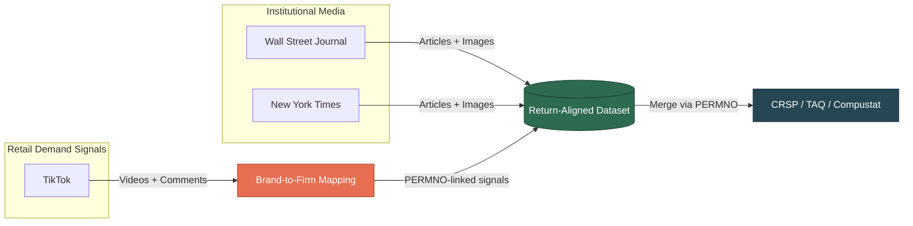
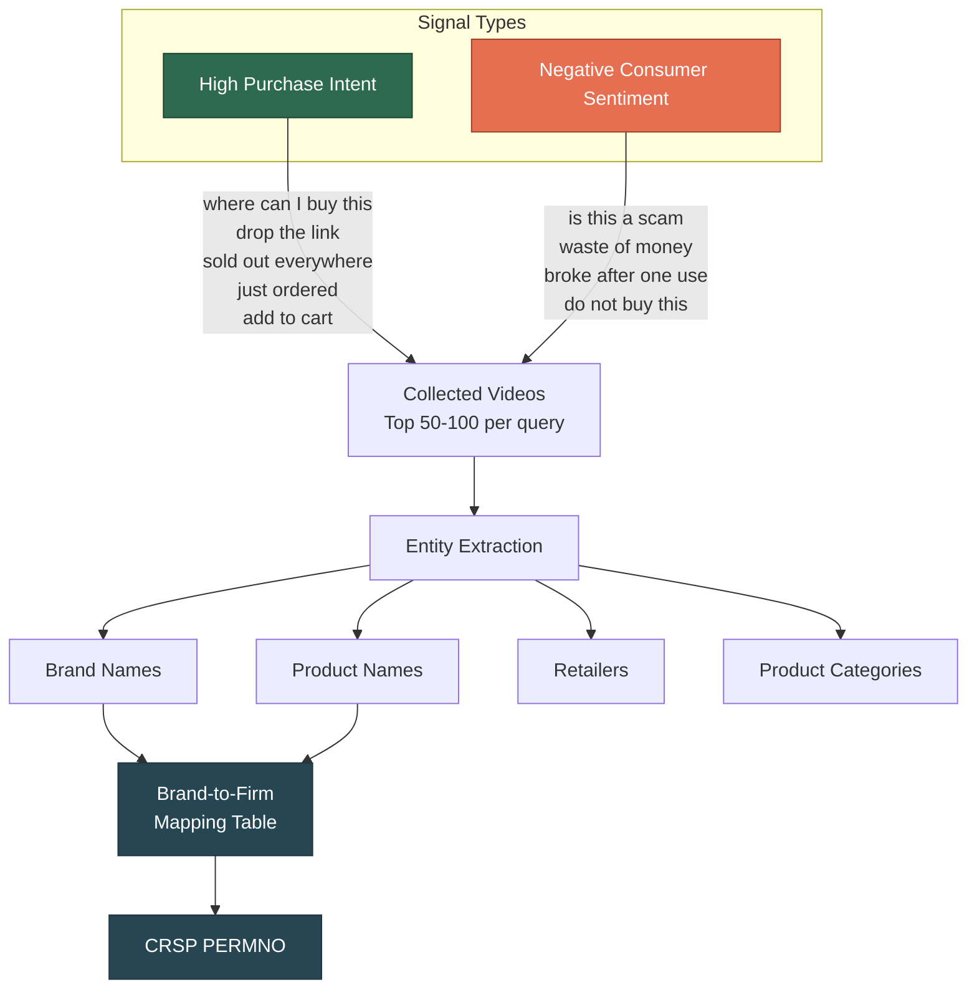
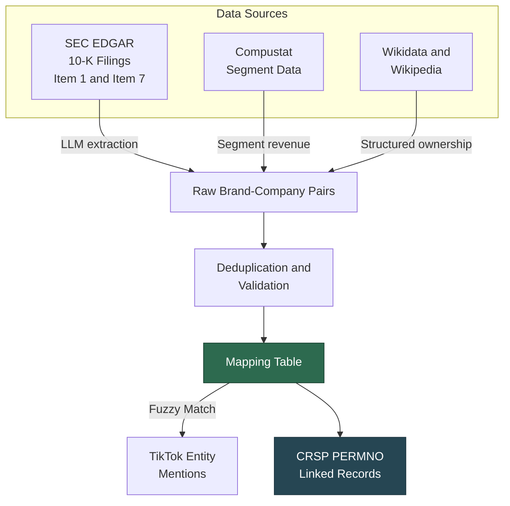
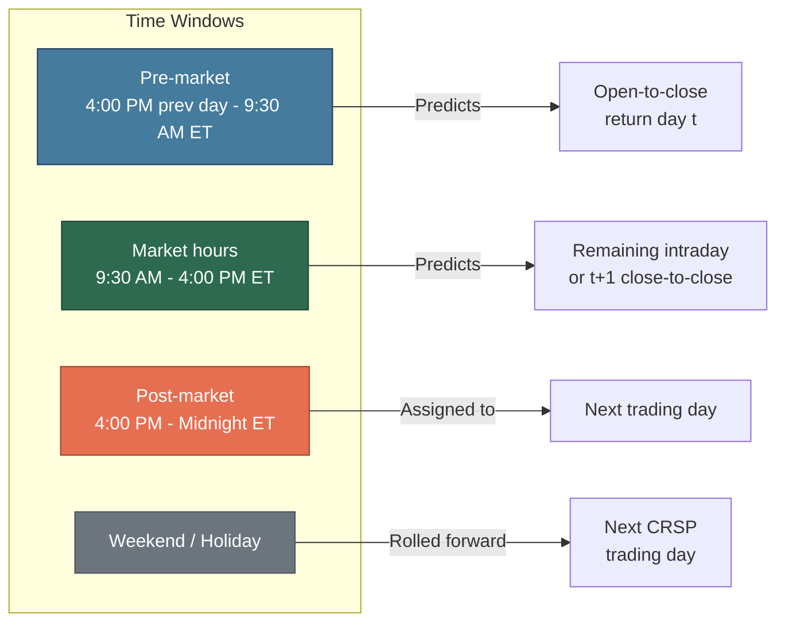
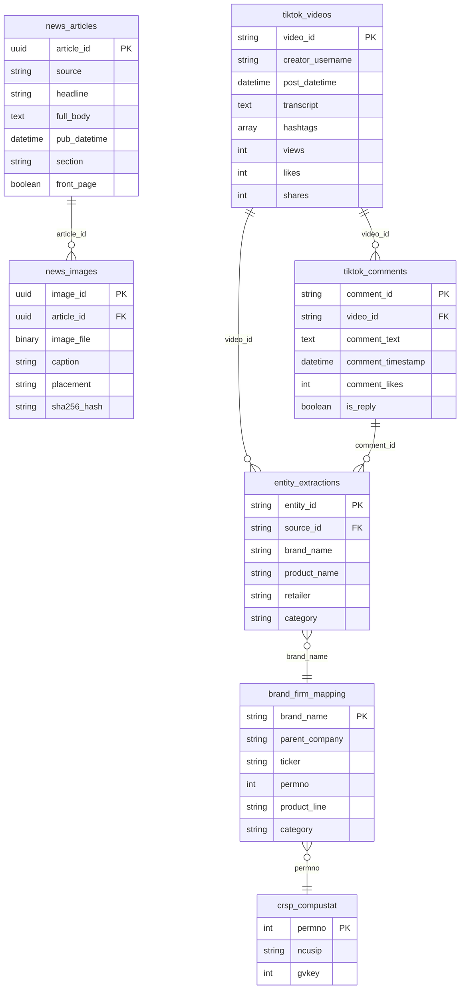
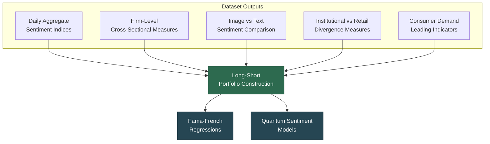

# TikTok Consumer Demand Signal Pipeline

Python pipeline for collecting product-level demand and negative sentiment signals from TikTok Research API, aligned to your protocol.

## What this implements

- Signal families:
  - High purchase intent phrases (exact list from protocol).
  - Negative sentiment phrases (exact list from protocol).
  - `#tiktokmademebuyit` with categories: skincare, fitness, kitchen, tech, supplements, shoes, snacks.
- Explicit exclusions:
  - Filters finance-centric text such as `#stocktok`, `#fintok`, `ticker`, and `investing` terms.
- Ex-ante fixed sampling rules:
  - For each query/window, fetch a larger candidate set and keep top `QUERY_VIDEOS_TARGET` by engagement score (`views + likes + comments`).
  - Also fetch random videos (`is_random=true`) and keep `RANDOM_LOW_ENGAGEMENT_TARGET` at or below ranked-sample engagement floor.
- First-pass capture discipline:
  - Saves video/comment snapshots immediately on first retrieval.
- Comment capture:
  - Scans up to `COMMENT_SCAN_LIMIT` comments per video, then stores top `COMMENTS_PER_VIDEO_TARGET` by likes.
- Entity extraction at collection time:
  - For every video/comment: brand-like mentions, product-like mentions, retailers, categories.
  - Stores both denormalized arrays and normalized mention rows.
- Brand-to-firm mapping support:
  - Loads CSV with parent company name, ticker, PERMNO, brand name, product line, and product category.

## Data model

### `tiktok_videos`

- `video_id` (PK)
- `creator_username`
- `post_datetime_utc` (ISO 8601 UTC)
- `full_transcript` (voice-to-text fallback to description)
- `all_hashtags`
- `number_of_views` / `number_of_likes` / `number_of_shares` / `total_comments` (snapshot)
- `collection_timestamp`
- Query metadata and extracted entity arrays

### `tiktok_comments`

- `comment_id` (PK)
- `video_id` (FK)
- `comment_text`
- `comment_timestamp` (ISO 8601 UTC)
- `comment_likes`
- `reply_indicator` (0/1)
- `parent_comment_id`
- Extracted entity arrays

### `entity_mentions`

Normalized mention rows for downstream mapping and audit.

### `brand_firm_mapping`

Mapping output table for parent company, ticker, PERMNO, and brand/product/category metadata.

## Setup

1. Install dependencies: `pip install -r requirements.txt`
2. Copy `.env.example` to `.env` and fill credentials.

Required authentication:

- `TIKTOK_ACCESS_TOKEN`, or
- `TIKTOK_CLIENT_KEY` + `TIKTOK_CLIENT_SECRET`

## Run collection

```bash
python run_pipeline.py collect --env-file .env
```

## Load brand-to-firm mapping

1. Prepare CSV with required columns (see `mapping_template.csv`).
2. Load into SQLite:

```bash
python run_pipeline.py load-mapping --csv mapping_template.csv --env-file .env
```

## API alignment

- Video endpoint: `POST /v2/research/video/query/`
- Comment endpoint: `POST /v2/research/video/comment/list/`
- Uses documented `query` object (`and`/`or`/`not`, `field_name`, `operation`, `field_values`), pagination (`cursor`, `search_id`), and date bounds (`start_date`, `end_date`, `YYYYMMDD`).
- Keeps each request window within 30 days (`WINDOW_DAYS=30` by default).

# Quantum-Enhanced Visual Sentiment Analysis for Financial Market Prediction

## Full Data Collection Plan (Revised)

---

## I. Research Objective (Asset Pricing Orientation)

This project constructs a return-aligned financial media dataset engineered specifically to test whether institutional and retail media sentiment predicts stock and market returns.

The database must allow construction of:

1. Daily aggregate (market-level) sentiment indices
2. Daily firm-level cross-sectional sentiment measures
3. Attention-weighted and velocity-adjusted sentiment signals
4. Image-based vs text-based sentiment comparisons
5. Institutional vs retail sentiment divergence measures
6. Clean merges with: CRSP daily returns, TAQ intraday data, Compustat fundamentals

**Core principle:** Every data field collected must directly support causal mapping from media exposure to subsequent returns.

---

## II. Data Sources Overview

We collect from three channels to capture the full investor information environment:

1. **Wall Street Journal (WSJ)** — institutional media
2. **New York Times (NYT)** — institutional media
3. **TikTok** — retail consumer demand and sentiment channel

These allow identification of: institutional information effects, retail consumer demand signals as leading indicators of firm revenue, media divergence, and information diffusion speed.



---

## III. WSJ and NYT Collection Protocol (Institutional Media)

**Access Method:** All articles obtained exclusively via MU Library licensed academic databases that explicitly permit Text and Data Mining (TDM). No website scraping.

**Time Window:** January 1, 2021 – Present. (Extend backward if needed for replication.)

### A. Article-Level Data (`news_articles` table)

For each article, collect:

| Field | Format | Purpose |
|-------|--------|---------|
| `article_id` | UUID, primary key | Unique identifier |
| `source` | WSJ or NYT | Source discrimination |
| `headline` | Full text | Sentiment extraction |
| `full_article_body` | Complete text (not abstract) | Sentiment extraction |
| `publication_date` | YYYY-MM-DD | Return alignment |
| `publication_time` | HH:MM:SS | Intraday alignment |
| `timezone` | ISO 8601 UTC | Bias prevention |
| `section_category` | Markets, business, economy, etc. | Isolate market-relevant content |
| `front_page_flag` | Boolean | Attention proxy |
| `author_names` | Text | Journalist fixed effects |
| `word_count` | Integer (derived) | Salience proxy |
| `database_source_id` | Text | Audit trail |

### B. Image-Level Data (`news_images` table)

Images are critical because prior research shows photograph sentiment predicts returns.

For each image associated with each article, collect:

| Field | Format | Purpose |
|-------|--------|---------|
| `image_id` | UUID, primary key | Unique identifier |
| `article_id` | Foreign key | Relational link |
| `image_binary` | JPEG/PNG (no recompression) | Visual sentiment extraction |
| `image_caption` | Full text | Caption sentiment |
| `placement` | Lead / inline / thumbnail | Attention weighting |
| `image_order` | Integer | Position within article |
| `resolution` | Width × height (px) | Quality filtering |
| `sha256_hash` | Text | Deduplication |

**Operational Rules:** Store original image file without compression. Generate SHA256 hash for deduplication. Store images separately from articles. Link relationally via `article_id`.

---

## IV. TikTok Consumer Demand Signal Collection Protocol

### Objective

Capture product-level consumer demand signals and negative sentiment from TikTok as leading indicators of publicly traded firm revenue. TikTok is not a financial discussion platform. Users do not discuss stocks by ticker symbol. Instead, they discuss products, brands, and consumer experiences. This product-level buzz is the signal we want, because it is a leading indicator of firm revenue before it shows up in earnings reports. This is the basis of what practitioners call **social arbitrage**.

We are looking for two types of signals:

1. **High purchase intent** — rising consumer demand for a product before it hits official sales numbers.
2. **Negative consumer sentiment** — quality problems, shipping failures, or trust breakdowns that may foreshadow revenue misses or brand damage.

**Explicitly exclude:** direct financial discussion content (#stocktok, #fintok), ticker-symbol searches, and generic investing hashtags. These do not reflect how TikTok is actually used and would yield negligible relevant data.



### A. Search Query Strategy

#### High Purchase Intent Queries

Use these exact search phrases:

- "where can I buy this"
- "is there a link"
- "drop the link"
- "how much is this"
- "is this on amazon"
- "need this now"
- "shut up and take my money"
- "add to cart"
- "just ordered"
- "sold out everywhere"

Also search for the hashtag **#tiktokmademebuyit** combined with product categories: skincare, fitness, kitchen, tech, supplements, shoes, and snacks.

#### Negative Consumer Sentiment Queries

Use these exact search phrases:

- "is this a scam"
- "don't buy this"
- "waste of money"
- "looks cheap"
- "took forever to ship"
- "never arrived"
- "broke after one use"
- "not worth it"
- "return this"

### B. Sampling Procedure

For each query, collect the top 50 to 100 videos sorted by engagement (views + likes + comments). Start with the past 12 months and work backward as far as the data allows. Also collect a random sample of lower-engagement videos for the same queries so we can separate the sentiment signal from the attention signal.

Sampling rule must be fixed ex ante to prevent selection bias.

> **⚠️ Critical:** Save everything on first contact. TikTok content disappears fast. Do not plan to go back later for transcripts or comments. Treat every first pass as if the video will be gone tomorrow.

### C. Video-Level Data (`tiktok_videos` table)

For each video collected, store:

| Field | Format | Purpose |
|-------|--------|---------|
| `video_id` | Primary key | Unique identifier |
| `creator_username` | Text | Creator tracking |
| `post_datetime` | ISO 8601 UTC | Return alignment |
| `full_transcript` | Text (auto-captions or ASR) | Sentiment extraction |
| `hashtags` | Array | Topic clustering |
| `views` | Integer (snapshot) | Attention proxy |
| `likes` | Integer (snapshot) | Engagement proxy |
| `shares` | Integer (snapshot) | Virality proxy |
| `total_comments` | Integer (snapshot) | Discussion intensity |
| `collection_timestamp` | ISO 8601 UTC | Snapshot time audit |

### D. Comment-Level Data (`tiktok_comments` table)

For each video, collect the full text of at least the top 100 comments sorted by likes.

| Field | Format | Purpose |
|-------|--------|---------|
| `comment_id` | Primary key | Unique identifier |
| `video_id` | Foreign key | Relational link |
| `comment_text` | Full text | Sentiment extraction |
| `comment_timestamp` | ISO 8601 UTC | Temporal analysis |
| `comment_likes` | Integer | Comment salience |
| `reply_indicator` | Boolean | Thread structure |
| `parent_comment_id` | Foreign key (if reply) | Thread structure |

### E. Entity Extraction (Critical for Firm Mapping)

For every video and every comment, extract and record:

- Every **brand name** mentioned
- Every **product name** mentioned
- Every **retailer** mentioned (Amazon, Target, Walmart, Sephora, etc.)
- Every **product category**

These are the fields we will use to map TikTok content to publicly traded companies. This extraction must happen at collection time, not as a post-processing step, because it determines which records are usable in the final dataset.

---

## V. Brand-to-Firm Mapping Protocol

After collecting TikTok data, every brand and product mention must be mapped to its publicly traded parent company. The goal is a lookup table where every brand or product name that appears in the TikTok data maps to a CRSP PERMNO. This mapping must account for subsidiaries, brand acquisitions, and private companies (which we exclude). Not every product will map to a public company, and that is fine. We only use the ones that do.



### A. SEC 10-K Filings

Every public company describes its major products, brands, and business segments in its annual report. Download 10-K filings from EDGAR for all firms in the CRSP universe. Use an LLM to read the business description sections (Item 1 and Item 7) and extract a structured table with columns for: parent company name, ticker, PERMNO, brand name, product line, and product category.

### B. Compustat Segment Data

Supplement with Compustat segment data, which breaks out revenue by business segment and sometimes by product line. This provides additional coverage for firms whose 10-K filings do not enumerate brands explicitly.

### C. Wikipedia and Wikidata

For additional coverage, use Wikipedia and Wikidata, which maintain structured brand ownership data. For example, Wikidata can identify that Celsius energy drink is made by Celsius Holdings (CELH), UGG boots by Deckers Outdoor (DECK), and Elmer's Glue by Newell Brands (NWL).

### D. Mapping Table Output

The final mapping table must contain:

| Column | Description |
|--------|-------------|
| `parent_company` | Legal entity name |
| `ticker` | Exchange ticker symbol |
| `permno` | CRSP PERMNO |
| `brand_name` | Consumer-facing brand |
| `product_line` | Specific product line |
| `product_category` | Category (skincare, tech, etc.) |

Fuzzy matching will be required on the TikTok side because creators use colloquial brand references (e.g., "Stanley cup" rather than "Stanley 1913," "Dyson Airwrap" rather than "Dyson Ltd.").

---

## VI. TikTok Research API

TikTok has a Research API that provides academic researchers access to public video data, comment text, and engagement metrics. MU qualifies as a non-profit academic institution. The PI will submit the application. The approval process takes approximately 2 to 4 weeks.

Once approved, the API allows querying historical video data by keyword, hashtag, and date range. You specify a `start_date` and `end_date`, and it returns archived video records including view counts, like counts, comment counts, and share counts. The daily quota is 1,000 requests per day, returning up to 100,000 records per day (100 records per request for videos and comments). The daily quota resets at midnight UTC.

The API returns archived engagement metrics rather than live counts, which is actually preferable for our purposes because it avoids survivorship bias from videos that were later deleted or made private.

**API documentation and application:** https://developers.tiktok.com/products/research-api/

> **Quota planning note:** The 1,000 requests/day cap with 100 records per request means 100K records/day maximum. For our target of 50–100 videos per query across dozens of queries, plus top-100 comments per video, the collection schedule must be planned carefully. Comments alone could consume quota quickly. Prioritize high-purchase-intent queries first, as that is the more novel signal.

---

## VII. Derived Attention Metrics

**Comment Velocity:**

$$V_i = \frac{C_i(0, 24h)}{24}$$

Where $C_i(0,24h)$ is the number of comments in the first 24 hours.

**Engagement Acceleration:**

$$A_i = \frac{d^2 E_i}{dt^2}$$

Where $E_i$ = cumulative engagement (likes + comments + shares).

These capture retail attention formation speed.

---

## VIII. Firm Identifier Mapping Protocol

All detected tickers, firm names, brand names, and product names must be mapped to:

- **CRSP PERMNO**
- **NCUSIP**
- **Compustat gvkey**

Must account for: ticker changes, mergers, delistings, multiple share classes, effective date ranges, and brand ownership changes over time.

Mapping must use historical reference tables to avoid survivorship bias.

---

## IX. Time Alignment (Look-Ahead Bias Prevention)

All timestamps stored in UTC. Classify each media event:



---

## X. Data Storage Architecture

All data stored in **Parquet** (primary) and **CSV** (secondary export). All timestamps: ISO 8601 format, timezone-aware, normalized to UTC.



Linked by: `article_id`, `image_id`, `video_id`, and brand/product name keys. Designed for merging with CRSP, TAQ, Compustat via PERMNO.

---

## XI. Data Cleaning and Bias Controls

- Remove duplicate syndicated articles via hash matching
- Remove duplicate images via SHA256 hash
- Enforce minimum transcript length
- Flag deleted/private TikTok videos
- Validate brand/product entity extraction confidence
- Validate brand-to-PERMNO mapping accuracy (spot-check sample)
- Document query rules and sampling dates
- Store engagement snapshot time
- Separate sentiment signal from attention signal using low-engagement control sample

---

## XII. Final Deliverable

A multimodal, return-aligned, relational financial media dataset capable of:

- Replicating prior institutional media sentiment results
- Measuring incremental value of images over text
- Quantifying consumer demand signals as leading indicators of firm revenue
- Constructing long-short portfolios based on product-level social arbitrage
- Running cross-sectional Fama-French regressions
- Supporting classical and quantum sentiment models


